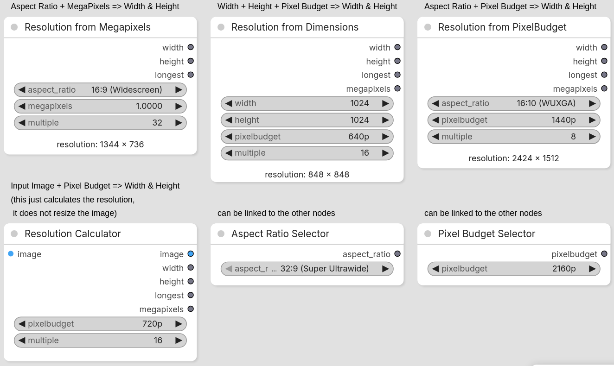

# ComfyUI-ResolutionHelper
Resolution Picker and Calculator

ComfyUI has several custom nodes for selecting image resolutions, but they typically require either width and height or megapixels as inputs. I wanted to specify the resolution using the vertical resolution (720p, 1080p, etc.), as is commonly done for display resolutions.

Note that selecting a vertical resolution such as 720p does not necessarily produce the exact dimensions of 1280x720. Instead, it returns dimensions that give the same number of pixels as a 1280x720 image. In other words, selecting 720p gives you 720p's worth of pixels, rather than forcing the image to be exactly 1280x720. Hence the name "pixel budget".

The aspect ratio selection nodes in ComfyUI also only provide a limited set of options. For example, many of them don't include a 16:10 aspect ratio. This Aspect Ratio Selector adds a few more.

# 6 nodes
 
 
# notes
- multiple [int]: width and height are rounded down to the nearest multiples of this value. 
- longest [int]: The larger of the width and height values. 
- megaPixels [float]: The number of pixels for the calculated width and height, expressed in megapixels.
